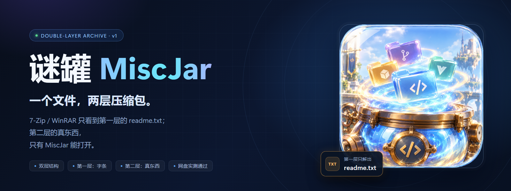
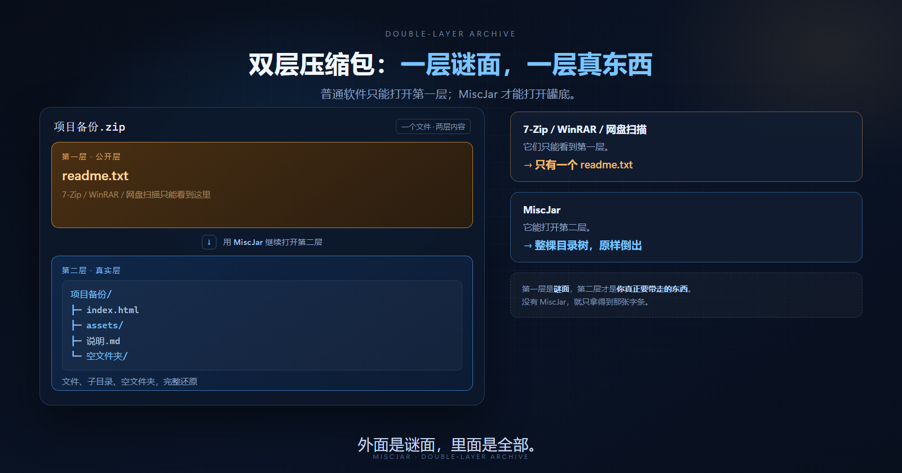

  

     

  <b>一个文件，两层压缩包。</b> 
  普通软件只看得到第一层的 <code>readme.txt</code>；谜罐才能打开罐底的真东西。

---

## 特性

谜罐（MiscJar）把一整个文件夹做成一个**双层压缩包**：

- **第一层：`readme.txt`** —— 给外人看的字条。7-Zip、WinRAR、网盘扫描只能看到这一层。
- **第二层：真实文件** —— 照片、代码、目录结构、空文件夹，完整藏在下面。只有 MiscJar 能打开。

**普通软件只能看见上一层，谜罐才能打开罐底的真东西。**

| 打开方式 | 看到什么 |
|---|---|
| 7-Zip / WinRAR / 常见解压软件 | 第一层的 `readme.txt` |
| 网盘自动扫描 | 同样只有第一层 |
| MiscJar | 第二层的完整目录树，逐字节还原 |

> [!NOTE]
> 它不加密文件，也不修改文件内容。它藏的是「压缩软件的第一眼」，不是「所有人的眼睛」。

  

## 为什么叫「谜罐」

罐子人人打得开，但先倒出来的，永远只有那张字条。

第一层是谜面，第二层才是你真正要带走的东西；钥匙不在压缩软件手里。

## 亮点

- **双层结构** —— 一层字条，一层真东西，共用一个 `.zip`。
- **第一层只露字条** —— 7-Zip、WinRAR 双击打开，真实文件一个不露。
- **第二层完整还原** —— 文件名、子目录、空文件夹，原样回来。
- **网盘实测通过** —— 上传、扫描、分享、下载、还原，一整轮跑通。
- **全本地** —— 不联网、不上传、无遥测。

## 下载

不用装环境，直接从 [Releases](https://github.com/kaikaiiiiiii/miscJar/releases/latest) 下载对应平台：

| 平台 | 文件 |
|---|---|
| Windows x64 | `MiscJar-vX.Y.Z-windows-x64.zip` |
| Windows arm64 | `MiscJar-vX.Y.Z-windows-arm64.zip` |
| macOS Apple Silicon | `MiscJar-vX.Y.Z-macos-arm64.zip` |
| macOS Intel | `MiscJar-vX.Y.Z-macos-x64.zip` |
| Linux x64 | `MiscJar-vX.Y.Z-linux-x64.tar.gz` |
| Linux arm64 | `MiscJar-vX.Y.Z-linux-arm64.tar.gz` |

Windows 解压后双击 `MiscJar.exe`；macOS 解压后打开 `MiscJar.app`（未签名，首次打开需右键 →「打开」）；Linux 解压后运行 `./MiscJar`。每个 release 附 `SHA256SUMS.txt`。

> [!TIP]
> Linux 若报 `The SUID sandbox helper binary was found, but is not configured correctly`：先 `sudo chown root:root chrome-sandbox && sudo chmod 4755 chrome-sandbox`（保留沙箱），或临时用 `./MiscJar --no-sandbox`（关闭沙箱，安全边界更低）。

  

拖入文件选「打包」，拖入谜罐选「解包」。左边是空罐，中间是待打包的三个条目，右边是 120 个条目的长列表。

一个 `项目备份.zip` 带走整棵目录树；用 7-Zip 打开，只能看见 `readme.txt`。

## 网盘实测

- 上传正常，网盘把它当作一个普通文件；
- 自动扫描通过：没有展开真实目录，也没有把里面的文件列出来；
- 下载后用 MiscJar 打开，文件、子目录、空文件夹一个不少。

> [!NOTE]
> 这是特定平台、特定时间的实测结果。网盘策略会变，谜罐不承诺对任何平台永久有效。请只在你有权处理的文件上使用，并遵守服务条款与当地法律。

## 原理

详见文档：[`docs/DESIGN.md`](docs/DESIGN.md) 与 [`docs/DATA_FORMAT.md`](docs/DATA_FORMAT.md)。

## 边界

- **它不是加密**：拿到谜罐、又装了 MiscJar 的人仍能取出全部内容。需要真正保密，请用专门的加密工具。
- **网盘策略会变**：今天的实测通过，不代表明天仍然通过。
- **还原会覆盖**：目标位置已有同名文件时直接覆盖，不提示、不备份。
- **不要解不可信的谜罐**：还原路径来自谜罐内容，当前版本没有做 `..` 越界校验。
- **桌面版提供六个平台产物**：Windows / macOS / Linux，各含 x64 与 arm64；macOS 版未签名、未公证，首次打开需右键「打开」。

## 构建与发布

桌面版由 GitHub Actions 在六个原生平台（Windows / macOS / Linux × x64 / arm64）构建：推送 `v*` tag 触发 [`.github/workflows/release.yml`](.github/workflows/release.yml)，跑全量测试 → 打包 → 打包版 selftest 验收 → 发布 zip / tar.gz 与 `SHA256SUMS.txt`。日常 push / PR 由 [`ci.yml`](.github/workflows/ci.yml) 在同样六个平台跑测试并打包验收。

本地打包：`cd gui && npm run package`（默认当前平台；也可以 `node make-package.js darwin arm64` 指定目标）。

## Agents

> ※ 项目代码完全由 GLM-5.3-Flash 周末与深夜免费版编写。

## 许可证

[MIT](LICENSE) © 2026 kaikaiiiiiii